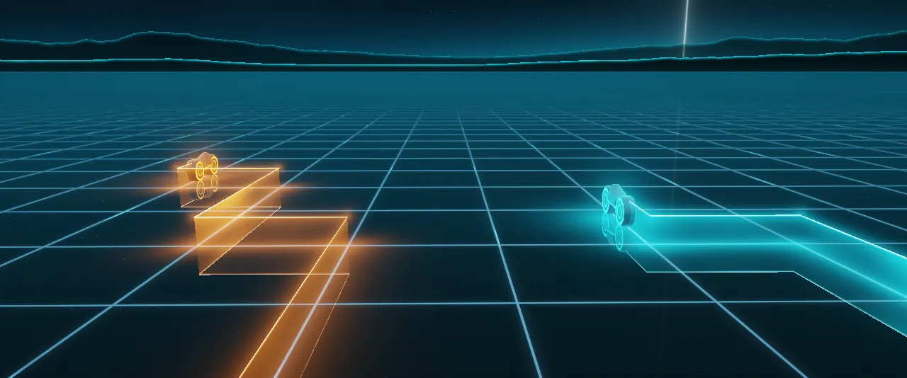
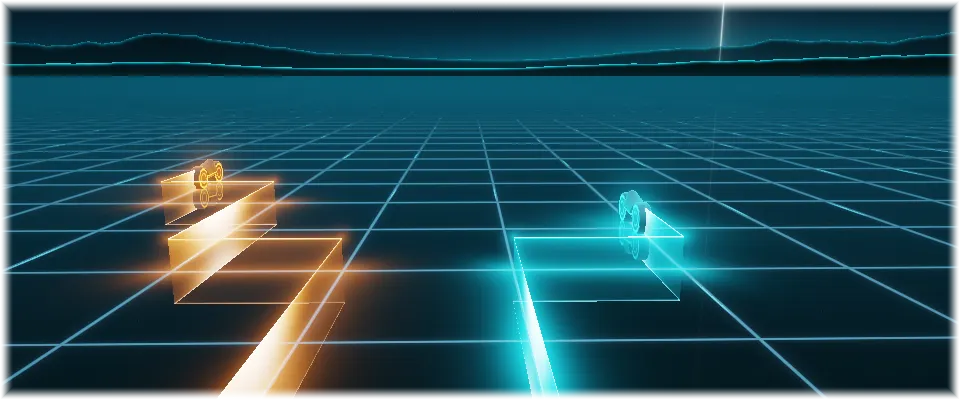

# Light Grid

An animated theme for [Omarchy](https://omarchy.org). Light-cycles racing over a glossy neon grid, laying walls of light under a stormy sky.

> **Animated with [omarchy-live-wallpaper](https://github.com/Gleasonmt/omarchy-live-wallpaper).**
> Install that plugin too (below) to make the wallpaper move and to get the
> **Light Grid Lite** version. Without it the theme still works, with a still wallpaper.



## Install

Theme and plugin together:

```bash
omarchy theme install https://github.com/Gleasonmt/omarchy-light-grid-theme && omarchy plugin add https://github.com/Gleasonmt/omarchy-live-wallpaper --enable --yes
```

or one at a time:

```bash
omarchy theme install https://github.com/Gleasonmt/omarchy-light-grid-theme
omarchy plugin add https://github.com/Gleasonmt/omarchy-live-wallpaper --enable
```

Then pick **Light Grid** in Omarchy menu → Style → Theme. The first line is the theme
(colors, wallpaper, icons, keyboard lighting); the second makes the wallpaper move,
and also adds **Light Grid Lite** to the picker: the same picture with only small
parts moving, which uses the least power. Without the plugin you get the theme
with a still wallpaper.

Update with `omarchy theme update` and `omarchy plugin update`.

## Light Grid Lite

The same scene, still, with only its small details alive. It uses the least power,
which makes it good for battery or a calmer desktop:



## How it moves

The wallpaper is a GPU shader (`live/1-the-grid.frag.qsb`, source in `src/`) drawn by the
[live-wallpaper plugin](https://github.com/Gleasonmt/omarchy-live-wallpaper);
`backgrounds/1-the-grid.png` is a frame of it, used by the lock screen and when the plugin
isn't installed. It pauses while a window covers the screen. See the plugin's README
for frame rates and battery settings.

Original artwork. The look is inspired by films and games; no logos or characters
are used.

## Performance

Measured on a Dell Latitude 9520 (Intel Iris Xe graphics, 8 threads) driving a 3440×1440
monitor, plugged in, with the plugin's default 30 fps. The wallpaper pauses whenever a window
covers the screen, so these are the costs while it's actually visible:

| Mode | GPU used | Wallpaper CPU | Compositor CPU |
|---|---|---|---|
| Still (plugin off) | ~0% | 2% | 4% |
| **Light Grid Lite** | ~56% | 6% | 5% |
| **Light Grid** | ~59% | 5% | 5% |

*GPU used* is how busy the GPU was, weighted by its clock speed against its maximum
(1350 MHz here). *CPU* is a share of one core.

This is the heaviest of the themes. Each pixel traces a ray through a 3D scene: the
glossy floor reflects the cycles, their light walls and the stormy sky, and the grid
lines are smoothed against shimmering. The scene is the same everywhere on screen, so
there is little hidden work to skip, and because the cycles ride across the whole grid,
Lite still redraws most of the screen. That's why Lite saves so little here.

If that's more than you want, these are optional, set in
`~/.config/omarchy/live-wallpaper.json` (see the
[plugin's README](https://github.com/Gleasonmt/omarchy-live-wallpaper)):

- **Half resolution**, `"renderScale": 0.5`: about **8.5%** GPU. The grid lines get a
  little softer up close. This is the biggest saving.
- **15 fps**, `"fps": 15`: about **32%** GPU. Everything stays sharp, but motion is less smooth.
- **Battery:** on battery the plugin already draws at half resolution and 10 fps by
  default (plugin 1.1.2 or later: run `omarchy plugin update`).

## Making changes

The scene is `src/<name>.frag` (with `src/common.glsl`): edit it, then run

```bash
tools/build.sh           # rebuilds live/, the still in backgrounds/ and preview.jpg
tools/build.sh --media   # also the animated previews in media/ (a few minutes)
```

and commit the results. Needs `qt6-shadertools`, `qt6-declarative`, ImageMagick and
(for `--media`) ffmpeg. To try a change on your own desktop, run
`omarchy theme update` after pushing, or copy the built files into
`~/.config/omarchy/themes/<name>/`.

## License

[MIT](LICENSE)
